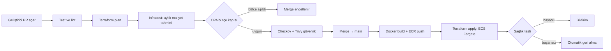

# FinOps Guard

**Yapay zekâ destekli, maliyet farkındalıklı CI/CD platformu (AWS)**

[](https://github.com/EmirSlhSnbl/cost-aware-cicd-aws/actions/workflows/pr.yml)

Beykoz Üniversitesi, Mühendislik ve Mimarlık Fakültesi bitirme projesi (2026).

> Bulutta bir ayarı değiştirdiğinizde faturanın ne kadar artacağını ay sonunda değil, **değişikliği yaptığınız anda** görün. Bütçeyi aşan değişiklik birleştirilmeden otomatik olarak durdurulur.

*English summary: FinOps Guard is a cost-aware CI/CD pipeline for AWS. On every pull request it estimates the monthly cost of infrastructure changes (Infracost), enforces a budget policy (OPA/Conftest), runs security scans (Checkov, Trivy), and after merge deploys to ECS Fargate with health checks and automatic rollback. A Python ML layer forecasts a P90 cost upper bound (trained on simulated billing data so far).*

---

## İçindekiler

1. [Problem](#problem)
2. [Nasıl çalışır](#nasıl-çalışır)
3. [Proje durumu](#proje-durumu)
4. [Özellikler](#özellikler)
5. [Depo yapısı](#depo-yapısı)
6. [Kurulum](#kurulum)
7. [Kullanım ve demo senaryoları](#kullanım-ve-demo-senaryoları)
8. [Yapılandırma](#yapılandırma-finops-guardyml)
9. [Yapay zekâ katmanı](#yapay-zekâ-katmanı)
10. [Güvenlik](#güvenlik)
11. [Maliyet uyarısı](#maliyet-uyarısı)
12. [Testler](#testler)
13. [Yol haritası](#yol-haritası)
14. [Sınırlılıklar](#sınırlılıklar)
15. [Kaynaklar](#kaynaklar)

---

## Problem

Bulut esnektir ama bu esneklik, tek bir yapılandırma satırının (örneğin bir görevin vCPU sayısının) aylık faturayı katlayabilmesi anlamına gelir. Fatura çoğu zaman ay sonunda fark edilir; değişikliği yapan kişi ile sonucu görecek kişi arasında haftalar geçer.

FinOps Guard bu **geri bildirim gecikmesini** kapatır: maliyet bilgisini ve maliyet politikasını, değişikliğin yapıldığı ana (pull request) taşır.

## Nasıl çalışır



Örnek: bir demo PR'da görev boyutu artırıldığında Infracost tahmini **11 $ → 245 $** olmuş ve 30 $'lık bütçe politikası birleştirmeyi engellemiştir.

## Proje durumu

| Alan | Durum |
|---|---|
| AWS güvenlik temeli, bütçe uyarısı, Flask uygulaması, Docker | ✅ Tamamlandı |
| Terraform altyapısı (network, ECR, ECS Fargate) ve GitHub OIDC | ✅ Tamamlandı |
| PR iş akışı, zorunlu denetimler (Ruleset), Infracost yorumu | ✅ Tamamlandı |
| OPA/Conftest bütçe ve Terraform politikaları, Checkov, Trivy | ✅ Tamamlandı |
| Otomatik dağıtım, sağlık testi, geri alma, bildirim, teardown | ✅ Tamamlandı |
| Benzetilmiş fatura veri katmanı (`ml/`) | ✅ Tamamlandı |
| P90 tahmin modelleri (kantil regresyonu + uyumlu kalibrasyon) | ✅ Tamamlandı (benzetim verisi) |
| Yapılandırılabilir bütçe politikası (`finops-guard.yml`) ve örnek site | 🔄 Devam ediyor |
| Kaynak bazlı fiyat dökümü: ALB, RDS, S3, DynamoDB (Terraform anahtarları) | 🗓 Planlandı |
| P90 tahmininin PR yorumuna ve bütçe kapısına bağlanması, tasarruf önerisi | 🗓 Planlandı |
| Otomatik kapatma (dev ortamı) | 🗓 Planlandı |
| `/admin` maliyet panosu | 🗓 Planlandı |
| Anomali tespiti, gerçek veriyle doğrulama | 🗓 Planlandı |
| AI Maliyet Danışmanı (salt okunur, ölçümlü) | 🗓 Planlandı |
| Şablon depo ve bootstrap betiği | 🗓 Planlandı |

## Özellikler

**Maliyet kontrolü**
- Her PR'da Infracost ile aylık maliyet tahmini ve PR yorumu.
- OPA/Conftest ile bütçe politikası: `deny` (engelle) ve `warn` (uyar).
- Politika birim testleri.

**Güvenlik**
- Checkov ile Terraform taraması (gerekçeli istisnalar `.checkov.yaml` içinde).
- Trivy ile konteyner imajı taraması (CRITICAL/HIGH).
- AWS'ye kalıcı anahtar olmadan, GitHub OIDC ile bağlanma; PR için yalnızca *plan*, `main` için *apply* rolü.
- Dal koruma (Ruleset) ile dört zorunlu denetim: `app`, `terraform`, `infracost`, `security`.

**Dağıtım ve güvenilirlik**
- Merge sonrası otomatik dağıtım (imaj etiketi `sha-<7 karakter>`, ECR etiketleri değiştirilemez).
- ECS devre kesici (circuit breaker) ve sağlık testi; başarısız sürümde önceki sürüme otomatik geri alma.
- Elle çalıştırılan `teardown` iş akışı ile tüm kaynakların kaldırılması.

**Yapay zekâ**
- Statik tahmin, oran-kantil kuralı ve gradyan artırma kantil regresyonu karşılaştırması.
- Uyumlu (conformal) kalibrasyon; pinball kaybı ve P90 kapsaması ile değerlendirme.

## Depo yapısı

```
.
├── .github/workflows/
│   ├── pr.yml          # PR denetimleri (app, terraform, infracost, security)
│   ├── deploy.yml      # main'e merge sonrası dağıtım, sağlık testi, geri alma
│   └── teardown.yml    # elle çalışan yıkma iş akışı
├── app/                # Flask uygulaması, Dockerfile, testler
├── terraform/
│   ├── bootstrap/      # S3 durum bucket'ı, OIDC sağlayıcısı ve roller
│   ├── modules/        # network, ecr, ecs
│   └── envs/dev/       # dev ortamı
├── policy/
│   ├── cost/           # bütçe politikası (Rego) ve testleri
│   └── terraform/      # Terraform plan politikaları
├── ml/                 # benzetici, özellikler, modeller, değerlendirme, testler
├── finops-guard.yml    # yapılandırma (bütçe, profil, ortam)  [geliştiriliyor]
├── .checkov.yaml
└── docs/               # haftalık notlar
```

## Kurulum

> Bu depo bir AWS hesabına bağlanır. Yanlış yapılandırma ücret doğurabilir; önce [Maliyet uyarısı](#maliyet-uyarısı) bölümünü okuyun.

**Önkoşullar:** AWS hesabı (bütçe uyarısı açık), GitHub hesabı, Terraform ≥ 1.10, Python 3.12, Docker, Infracost hesabı (ücretsiz API anahtarı).

1. Depoyu çatallayın ya da kopyalayın.
2. `terraform/bootstrap` ile durum bucket'ını ve OIDC rollerini (plan/apply) oluşturun. Rol ilkeleri GitHub kimliğini (`sub`) **sayısal ID** ile doğrular.
3. GitHub deposunda şunları tanımlayın:

   | Tür | Ad | Açıklama |
   |---|---|---|
   | Repository **Variable** | `AWS_PLAN_ROLE_ARN` | PR'larda kullanılan salt-okunur plan rolü |
   | Repository **Variable** | `AWS_APPLY_ROLE_ARN` | `main` için apply rolü |
   | Repository **Secret** | `INFRACOST_API_KEY` | Infracost API anahtarı |

   Bildirim sırları (e-posta/webhook) isteğe bağlıdır; boşsa bildirim adımları atlanır.
4. `main` dalı için bir Ruleset oluşturun ve dört denetimi zorunlu kılın (`app`, `terraform`, `infracost`, `security`).
5. İlk PR'ı açın; Infracost yorumu ve bütçe kapısı otomatik çalışır.

> **Sır yönetimi:** Hesap kimliği, IP adresi, anahtar ve parola depoya yazılmaz. Rol ARN'leri Variable, anahtarlar Secret olarak tutulur.

## Kullanım ve demo senaryoları

1. **Pahalı değişiklik engellenir:** Görev boyutunu büyüten bir PR açın. Infracost yorumu önce/sonra fiyatı gösterir, bütçe politikası denetimi kırmızıya döner, merge engellenir.
2. **Güvenli değişiklik geçer:** Küçük bir kod değişikliği tüm denetimleri geçer; merge sonrası otomatik dağıtım yapılır.
3. **Hatalı sürüm geri alınır:** `CHAOS_UNHEALTHY=1` ile sağlıksız bir sürüm yayınlanır; sağlık testi/devre kesici başarısız olur ve sistem önceki sürüme döner.

Uygulama uçları: `/health`, `/version`, `/work?ms=1..500` (yük üretmek için).

## Yapılandırma (`finops-guard.yml`)

> Bu bölüm geliştirme aşamasındadır (Hafta 8).

Politika **kodu** ile politika **değerleri** ayrıdır. Bütçe ve davranış, politika dosyasına dokunmadan yapılandırmayla değişir:

```yaml
profile: solo            # solo | startup | enterprise
environment: dev

budget:
  monthly_usd: 30
  mode: block            # block = engelle, warn = yalnızca uyar
  warn_at_percent: 80

environments:
  dev:  { monthly_usd: 30 }
  prod: { monthly_usd: 400, mode: warn }

rules:
  max_increase_percent: 0   # 0 = kapalı
```

Öncelik: `environments` > `budget` > `profile` > yerleşik varsayılan. Maliyet verisi okunamazsa politika **güvenli tarafta** kalır ve PR'ı reddeder (fail-closed).

## Yapay zekâ katmanı

`ml/` dizini, gerçek fatura verisi olmadığı için **benzetilmiş Fargate faturaları** üzerinde çalışır. Tahmin hedefi, PR anında bilinen özelliklerle (ortam, vCPU, bellek, görev sayısı, çalışma süresi varsayımı) **%90 olasılıkla aşılmayacak aylık maliyet üst sınırıdır (P90)**. Gerçek çalışma süresi gibi gizli değişkenler model girdisi değildir (bilgi sızıntısı önlenir).

Karşılaştırılan yöntemler: statik tahmin (730 saat), oran-kantil kuralı, gradyan artırma kantil regresyonu (log hedef, uyumlu kalibrasyon).

Benzetim test kümesi (n = 400, tek bölünme) sonuçları:

| Model | P90 kapsama (%) | Pinball kaybı |
|---|---|---|
| Statik (730 saat) | 80,8 | 9,100 |
| Oran-kantil kuralı | 88,0 | 1,962 |
| GBM kantil regresyonu | 87,5 | 2,348 |

> **Dikkat:** Bu rakamlar benzetim verisine dayanır ve gerçek faturayı temsil etmez. Statik tahmin ortalamada %80,8 kapsıyor görünse de prod ortamında yalnızca %4,1 kapsar (dev ortamında aşırı, üretimde yetersiz kalır). Basit oran-kantil kuralı karmaşık modelden daha düşük kayıp verdi; bu yüzden kural tabanlı yedek mekanizma planlanmıştır. Gerçek veriyle doğrulama yol haritasındadır.

## Güvenlik

- AWS erişimi kalıcı anahtarsız (GitHub OIDC); rol ayrımı: PR için *plan*, `main` için *apply*.
- Checkov, Trivy ve politika denetimleri zorunlu; atlanan Checkov kuralları gerekçeleriyle belgelidir.
- Konteyner imajları değiştirilemez etiketlerle yayınlanır; uygulama güvenlik başlıkları ve JSON günlük kullanır.
- CI iş akışlarında en az yetki ilkesi izlenir (yalnızca gereken `permissions`).
- **Bilinen not:** Bütçe politikası şu an PR dalındaki kopyadan okunur. Daha sıkı bir kurulumda politika ve yapılandırma taban daldan (`base`) okunmalıdır, aksi hâlde bir PR kendi bütçesini yükseltebilir.

## Maliyet uyarısı

Sistem düşük maliyet için yük dengeleyici ve NAT kullanmadan çalışır (0,25 vCPU, 0,5 GB Fargate, yaklaşık günde 0,45 $; fiyatlar yaklaşıktır ve bölgeye göre doğrulanmalıdır). Kullanmadığınız zaman:

- GitHub → Actions → **Teardown** iş akışını çalıştırın (onay metni: `destroy`).
- AWS Budgets uyarınızın açık olduğundan emin olun.

ALB ve RDS gibi bileşenler eklendiğinde günlük maliyet artar; bunlar yalnızca demo ve ölçüm sırasında açılmalıdır.

## Testler

| Küme | İçerik |
|---|---|
| Uygulama | 16 birim testi, %100 kapsama (kapsama kapısı: %90) |
| Politika | Terraform ve bütçe politikaları için Rego birim testleri (`conftest verify`) |
| ML | 33 test (veri katmanı ve modeller) |
| Boru hattı | Konteyner duman testi, Terraform `fmt`/`validate`/`plan`, Checkov, Trivy |

Yerelde (Windows/PowerShell, sanal ortam etkinken):

```powershell
cd app
python -m ruff check .
python -m pytest -q
```

> Windows Uygulama Denetimi `.exe` dosyalarını engelliyorsa `pytest` ve `ruff` yerine `python -m pytest` / `python -m ruff` kullanın.

## Yol haritası

| Hafta | İş |
|---|---|
| 1–7 | ✅ Güvenlik temeli, Terraform + OIDC, PR iş akışı, politikalar, dağıtım/geri alma, veri katmanı, P90 modelleri |
| 8 | 🔄 Yapılandırılabilir bütçe politikası, kapsamlı örnek site, kaynak bazlı fiyat (ALB/RDS/S3/DynamoDB anahtarları) |
| 9 | 🗓 P90 tahmini PR yorumuna ve bütçe kapısına bağlanır; tasarruf önerisi |
| 10 | 🗓 Otomatik kapatma ve tasarruf ölçümü |
| 11 | 🗓 `/admin` maliyet panosu |
| 12 | 🗓 Anomali tespiti; gerçek veriyle doğrulama |
| 13 | 🗓 AI Maliyet Danışmanı (salt okunur, ölçümlü, prompt injection önlemleriyle) |
| 14 | 🗓 Şablonlaştırma (yeniden kullanılabilir iş akışı + bootstrap), final rapor ve sunum |

## Sınırlılıklar

- Tahmin kesin fatura değildir; trafiğe bağlı kalemler (veri aktarımı, günlükleme, I/O) önceden bilinemez.
- Modeller şu an benzetim verisiyle eğitilmiştir; sonuçlar gerçek veriyle doğrulanana kadar kesin sayılmamalıdır.
- Yalnızca **AWS + Terraform** desteklenir; tek bulut ve tek hizmet türü (Fargate) üzerinde denenmiştir.
- Tek geliştirici ve küçük bir uygulama ile sınanmıştır; büyük kurumsal ortamlara (çok hesaplı yapı, onay akışları, denetim kayıtları) genellenemez.
- Fiyat bilgisi Infracost'un fiyat veritabanına bağlıdır.
